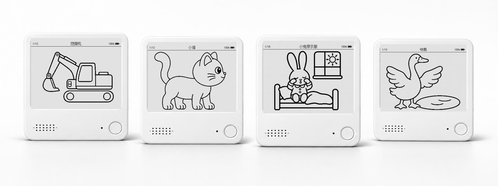
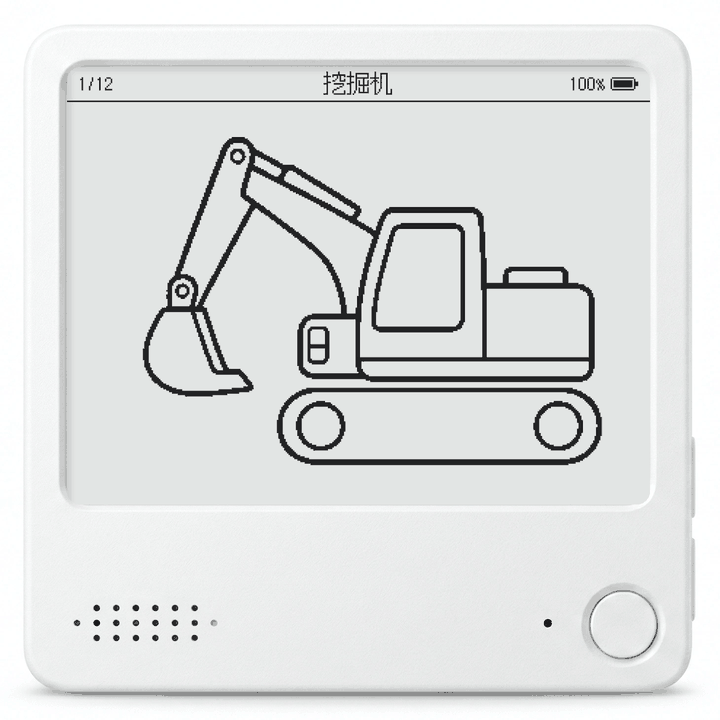
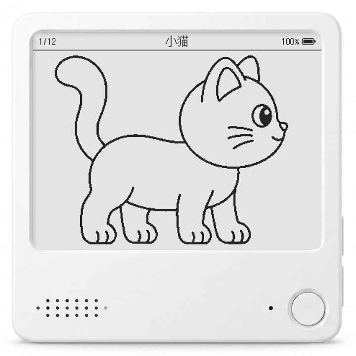
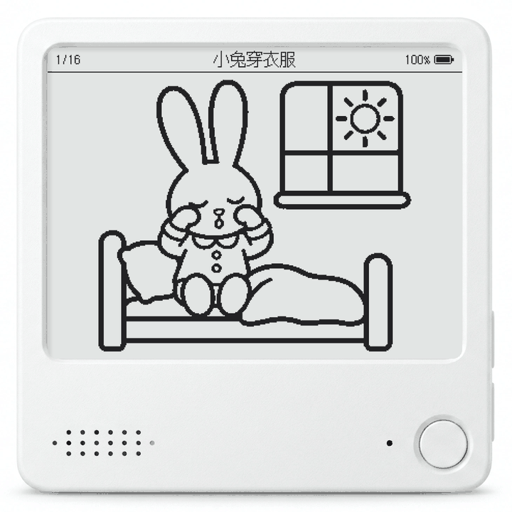
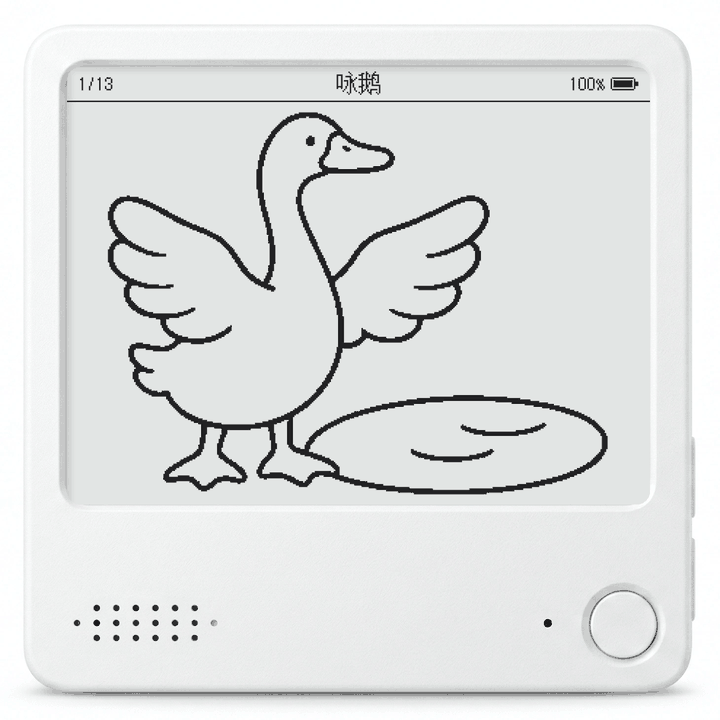
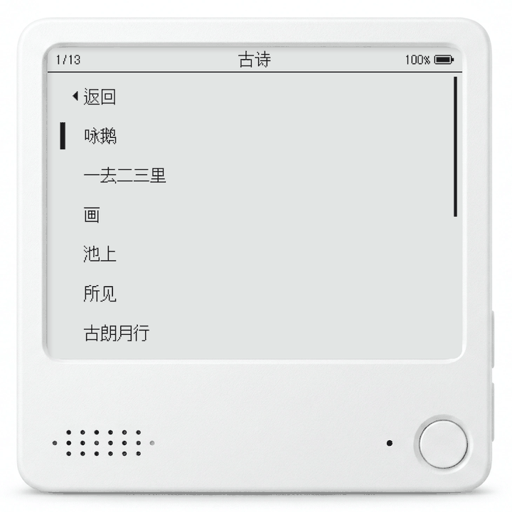
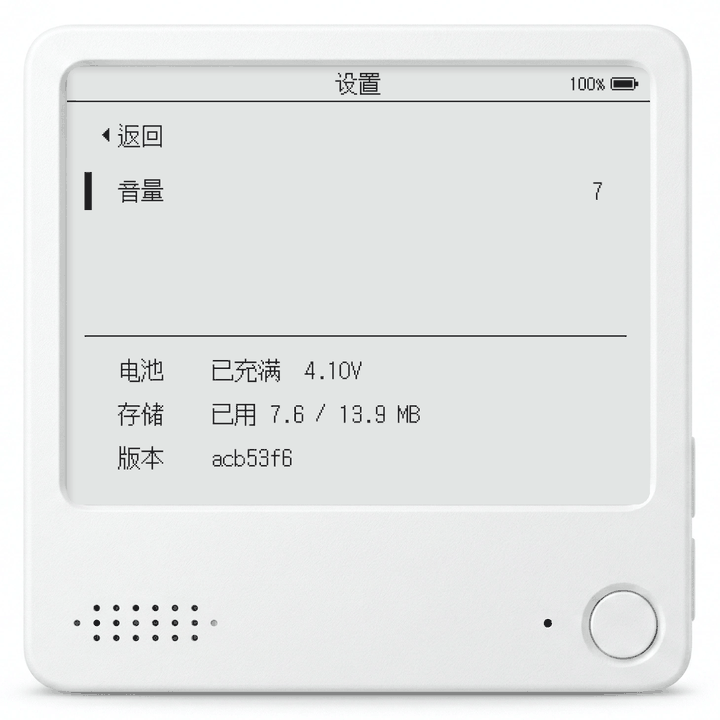

# Chalk



Chalk（粉笔）是跑在 ZecTrix Note4（ESP32-S3 + 4.2" 400×300 黑白墨水屏）上的儿童绘本、古诗，以及工程车和小动物动画。

内容在 Mac 上编译成 LittleFS 镜像，和固件一起烧进设备。设备不联网、没有后端，只负责显示和播放。

## 玩法

内容分四组：工程车、小动物、小故事、古诗，组内每一项是一辆车、一只动物、一个故事或一首诗。平时显示当前组当前项的画面。内容画面里不放文字，内容靠朗读；列表和设置页是文字列表。

- **工程车**：12 辆车，翻到时念一句，同时播一遍关键帧动画；念完、动画播完就停在这一辆。
- **小动物**：12 种动物，播放方式同工程车。
- **小故事**：先念标题，再逐页播放：每页一张插图配一段旁白，念完停 1.5 秒翻到下一页，播到最后一页停下。
- **古诗**：先念「诗名，作者」，然后一句一页，最后一页把全诗连起来念一遍，翻页方式同小故事。

<p>
  
  
  
  
</p>

有哪些组、组里有哪些项、顺序如何，见 `content/library.yaml`。

## 按键

| 操作 | 行为 |
| --- | --- |
| 上 / 下 短按 | 组内上一项 / 下一项，到头循环 |
| 上 / 下 长按（1 秒） | 上一组 / 下一组：念组名，播那一组上次停留的项 |
| 确认 | 当前项从头再播（故事、古诗回到第一页并重念标题） |
| 上 + 下 同按 | 进入 / 退出列表 |
| 三键同按 | 进入 / 退出设置 |

- 内容画面里短按在松手时立即生效；按住到 1 秒时立即切组，松手不再算短按。确认键长按和短按一样。
- 列表和设置页里按下就生效（留 80 ms 判定是不是组合键，组合键不会先触发其中的单键），长按等于短按。
- 上下同时按住时再按下确认就是三键；没有按确认，上下都松开时进入列表。组合键期间不触发长按。
- 动画播放中按键会立即停下动画，执行这次按键。
- 刷屏期间连按的上下键累加步数，一次跳到目标、只刷一屏；其他按键只执行最后一个。
- 闲置 3 分钟且没插 USB 时深睡，画面保留。确认键或下键唤醒，唤醒的那次按键直接执行；上键不能唤醒。
- 深睡前保存每组停留的项、当前页、音量和屏幕上的整帧，唤醒后直接局刷。

<p>
  
  
</p>

### 列表

分两层，第一行都是带 ◀ 的「返回」，光标是行左侧的黑条。光标移动只局刷，不朗读。

- **项层**：进入列表时显示当前组的各项，光标停在当前项。确认播放那一项；「返回」到组层。
- **组层**：各组一行，光标停在刚才的组。确认进入那一组的项层；「返回」回到原来的内容接着播。

一屏 7 行，放不下时光标到边缘逐行滚动，右侧滑块显示位置。

### 设置

| 行 | 确认 |
| --- | --- |
| 返回 | 回到原来的内容接着播 |
| 音量 | 进入编辑：上 / 下调 1–10 档，每调一档用新音量响一声，再按确认结束 |

下方隔一道线只读显示三行：电池（电量或充电状态，加电压）、存储用量、固件版本（正式版显示 tag，如 `v0.1.0`；其他编译取 git 短提交号，有未提交改动时加 `+`）。进入时光标停在「音量」。

列表和设置页 30 秒无操作自动回到内容画面。

## 状态栏

顶部 24px，用 Zfull 点阵字体（16px 标题、12px 数字），底部一条分隔线。

| 位置 | 内容 |
| --- | --- |
| 左 | 当前项在组内的序号，如 `3/12`；列表里是光标位置 |
| 中 | 车名、故事名或诗名；列表项层显示组名，组层显示 `目录`，设置页显示 `设置` |
| 右 | 电量百分比 + 电池图标（细外框，内部按电量比例填充，与数字按墨迹上下对齐）；充电时百分比换成闪电，充满显示 `100%` |

电量每分钟读一次，按 10% 取整；插拔 USB、充满时立即更新。状态栏有变化才局刷。

## 刷新

| 类型 | 实测耗时 | 用途 |
| --- | --- | --- |
| 局刷 | 约 0.8 s | 默认：翻页、换车、动画关键帧、列表和设置页 |
| 全刷 | 约 1.2 s | 开机首帧；连续局刷 12 次后的下一次切换内容 |

列表和设置页只局刷；驱动在连续局刷 16 次时强制全刷一次。切换内容的预算留出了一段动画（最多 4 帧）的余量，动画中途不会全刷。

声音先于刷屏开始，刷新的等待被朗读盖住。

## 目录

| 目录 | 内容 |
| --- | --- |
| `firmware/` | ESP-IDF 5.5 固件 |
| `tools/` | Go 内容工具 `chalk`（生成插图和朗读、编译内容镜像）、字库源（`fonts/`，Zfull 的 LVGL 点阵）、串口调试脚本 |
| `content/` | 内容：文案和画面描述（`item.yaml`），以及生成好的插图、关键帧、朗读音频 |
| `docs/images/` | README 配图：设备样机和宣传图 |
| `.github/workflows/` | CI：构建内容和固件，推 tag 时发布整片镜像 |
| `build/` | 编译产物（不入库）：`fs/`、`storage.bin`、`preview/`、生图日志 `art-logs/` |

## 直接烧录

[Releases](https://github.com/qiujun8023/chalk/releases) 里的 `chalk-zectrix-note4-<版本>-full.bin` 是含固件和内容的整片镜像，不用构建，校验值在同目录的 `-sha256.txt`：

```bash
uvx esptool --chip esp32s3 write_flash 0x0 chalk-zectrix-note4-<版本>-full.bin
```

整片烧录会清掉设备上保存的位置和音量。

## 构建与烧录

需要 Go、ffmpeg（带 libopus）、uv（打包镜像时用 `uvx` 运行固定版本的 littlefs-python）、ESP-IDF 5.5。插图和朗读都已在仓库里，`chalk build` 不调 AI、不需要 key。

```bash
cd tools && go build -o chalk . && ./chalk build
cd ../firmware && idf.py -p /dev/cu.usbmodem2101 flash
```

- `chalk build` 生成 `build/storage.bin`，`idf.py flash` 会把它一起烧到 storage 分区；只改固件时用 `idf.py app-flash`。
- 重新烧内容镜像会清掉设备上保存的位置和音量。
- `build/preview/` 里有每一帧的 PNG 和每个形象的动画 `anim.gif`，不用烧录就能检查效果。
- storage 分区大小从 `firmware/partitions.csv` 读取。
- master 上的 CI（`build.yml`）是滚动构建，验证能从仓库完整构建；生成文件缺失或过期时失败。

### 发布版本

推送 `vX.Y.Z` annotated tag 发布，tag message 即 Release notes：

```bash
git tag -a v0.1.0
git push origin v0.1.0
```

```text
Chalk v0.1.0

- 内容：新增 ...
- 固件：修复 ...
```

`release.yml` 校验 tag（格式、annotated、正文非空、是最新的 tag），构建整片镜像（`idf.py merge-bin`），把它和 sha256 上传到同名 Release。固件版本号直接取 tag，不用另改文件。

### 生成插图和朗读

插图、关键帧和朗读都由 AI 生成后入库，生成和构建分开：`chalk gen` 调 AI 补齐缺失或过期的文件，`chalk build` 只检查并编译。

```bash
set -a; . ~/.config/secrets/env; set +a   # 提供 CHALK_TTS_API_KEY
tools/chalk gen                           # 生成全部缺失或过期的文件
tools/chalk gen poems/jing-ye-si          # 只处理某一项；路径相对 content/，可以是目录或文件
tools/chalk gen --redo poems/jing-ye-si/p03.ogg   # 不满意，重新生成
tools/chalk gen --lock stories/rainy-day/p01.png  # 手工改过图，接受当前文件
tools/chalk region base.png k1.png out.png        # 建议关键帧的 region，并输出标注图
```

- 每个内容目录的 `gen.lock` 记录其中各文件生成时的输入 hash。朗读的输入是文本和音色，插图的输入是画面描述和参考图；输入变了即过期，`chalk build` 报错，`chalk gen` 重新生成。
- 同目录的参考图（故事第 1 页、形象原图）是依赖：它重新生成后，引用它的图跟着过期。跨目录的参考图只借画风，不形成依赖。
- 内容里删掉的项或页，`chalk gen` 会删掉对应的生成文件。
- 插图用 Codex 的图像生成，并发数 `JOBS` 默认 6，日志在 `build/gen-logs/`。没写 `art` 的图是手工提供的（车辆原图），不参与生成。

朗读用 OpenAI 兼容的流式 `chat/completions` 接口合成，统一转成 24 kHz 单声道 32 kbps 的 Ogg Opus。

| 变量 | 默认 |
| --- | --- |
| `TTS_API_KEY` | 没有时取 `CHALK_TTS_API_KEY` |
| `TTS_BASE_URL` | `https://api.xiaomimimo.com/v1` |
| `TTS_MODEL` | `mimo-v2.5-tts` |
| `TTS_VOICE` | `冰糖` |

## 内容格式

`content/library.yaml` 列出各组和组内的项，每项是 `content/` 下含 `item.yaml` 的目录：车辆在 `vehicles/`，动物在 `animals/`，故事在 `stories/<名称>/`，古诗在 `poems/<名称>/`。车辆和动物都是 `figures` 类型（形象合集：每个形象一张原图、一句介绍、一段关键帧动画），展开成其中的每一个形象。一项的文案、画面描述和生成文件都在它自己的目录里。

```yaml
groups:
  - id: vehicles        # 组名朗读存为 content/groups/vehicles.ogg
    title: 工程车       # 列表行、状态栏标题，切组时朗读
    items: [vehicles]
  - id: stories
    title: 小故事
    items: [stories/get-dressed, stories/brush-teeth]
```

```yaml
type: story
title: 静夜思           # 状态栏标题，翻到时朗读（title.ogg）
author: 李白            # 可选：标题朗读成「静夜思，李白」
pages:                  # 第 n 页：插图 p0n.png，旁白 p0n.ogg
  - say: 床前明月光。
    art:                # 插图的画面描述
      ref: stories/rainy-day/p01.png   # 参考图：借画风或保持角色一致
      prompt: 夜晚的屋里，一位穿长袍的古代诗人坐在床边……
  - say: 疑是地上霜。
    art: 床前的地上铺着一片白白的月光……   # 只写描述时参考本目录的 p01.png
```

```yaml
type: figures
title: 小动物
figures:
  - id: cat            # content/animals/cat/：base.png、关键帧、intro.ogg
    name: 小猫
    intro: 小花猫，喵喵叫。喵——！     # 翻到时朗读，同时播放 frames
    art:               # 键是文件名：base.png 画原图（必须写 ref），其余在 base.png 上改出关键帧
      base.png:
        ref: vehicles/bus/base.png
        prompt: 一只圆脸大眼睛的小猫……
      k1.png: 小猫张开小嘴在叫……
    frames:
      - {image: k1.png, region: [1177, 426, 202, 154], ms: 600}
      - {image: base.png}
```

- `ref` 不含 `/` 时相对图片所在目录，否则相对 `content/`。

- 图片是白底纯黑线稿，任意尺寸，裁白边后等比缩放进状态栏下方区域，按 128 二值化成 1bpp。
- `region` 是源图像素 `[x, y, w, h]`，必须在图内：关键帧只取这个区域，其余用 `base.png`。AI 改图时不动的部分会有细微偏移，靠它保证逐像素一致，局刷时车身不闪。同一形象的所有帧共用一个缩放位置。
- `ms` 是这一帧刷完后的停留时间。

新增一个故事或一首诗：新建 `content/stories/<名称>/item.yaml`（或 `poems/`），按页写旁白和画面描述，加进 `library.yaml` 对应的组，运行 `chalk gen` 后检查插图和朗读，不满意的 `--redo`。页数不限。

## 调试

固件的日志和调试输入都走 USB Serial/JTAG。`tools/devkeys.py` 发送模拟按键并打印日志，注意打开串口会复位芯片：

```bash
tools/devkeys.py 'd 3 D 5 e 3 i'   # 字母是按键，数字是等待秒数
```

| 键 | 含义 |
| --- | --- |
| `u` `d` `e` | 上、下、确认短按 |
| `U` `D` | 上、下长按（切组） |
| `l` | 上 + 下（列表） |
| `m` | 三键（设置） |
| `s` | 立即深睡 |
| `i` | 打印状态 |
| `p` | 导出屏幕当前帧；加 `--dump <前缀>` 保存为 PNG |

## 硬件

引脚定义见 `firmware/main/bsp/config.h`，电源和音频上电时序见 `bsp/board_power.h`、`power/sleep.cc` 的注释。分区：

| 分区 | 偏移 | 大小 | 用途 |
| --- | --- | --- | --- |
| `nvs` | `0x9000` | 24 KB | 未使用 |
| `phy_init` | `0xf000` | 4 KB | 未使用 |
| `factory` | `0x10000` | 2 MB | 固件 |
| `storage` | `0x210000` | 约 14 MB | LittleFS：内容、`state.json`、`screen.bin` |

## 许可证

- **代码**（`firmware/`、`tools/` 等）：[MIT](LICENSE)
- **内容**（`content/` 下的线稿、插图和文案）：[CC BY-NC-SA 4.0](LICENSE-CONTENT)，转载请署名、注明出处，不得用于商业用途，改编后须以相同协议发布
